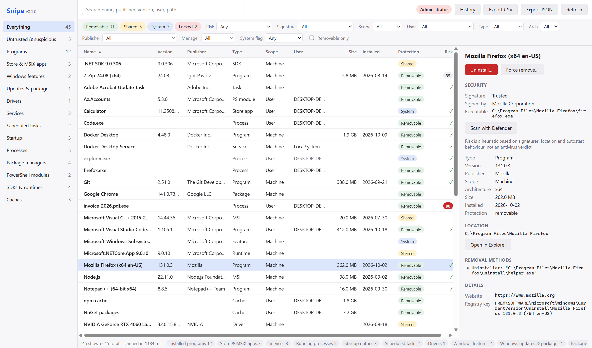
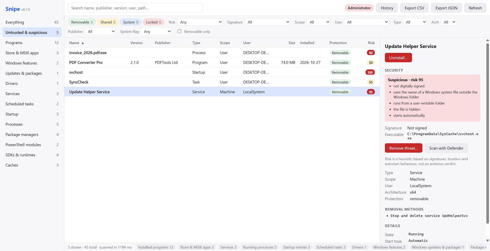
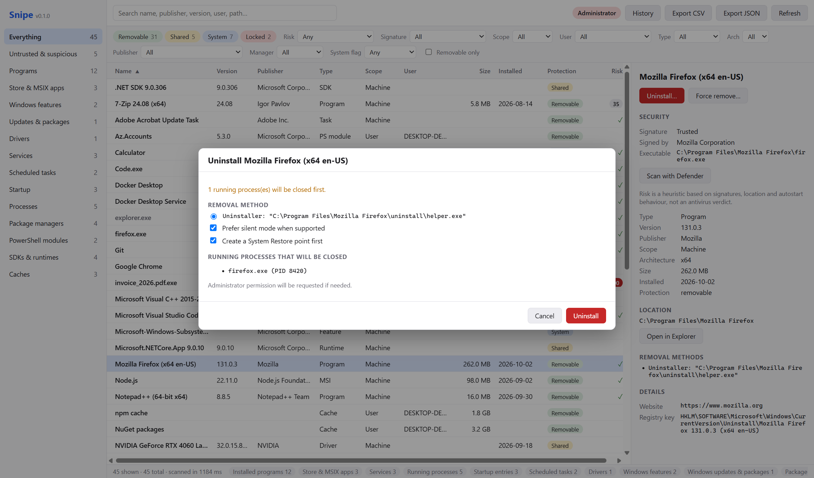
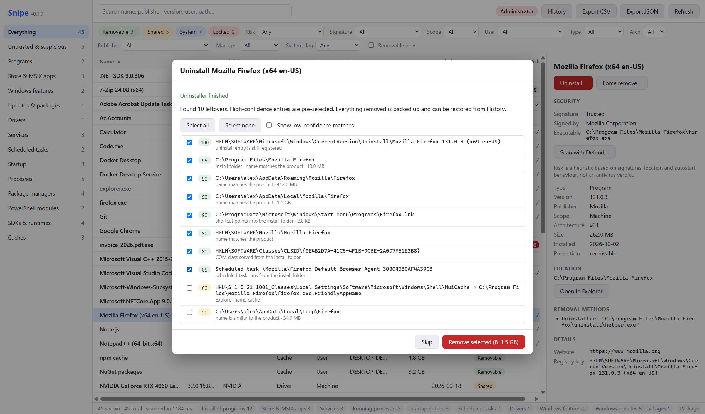
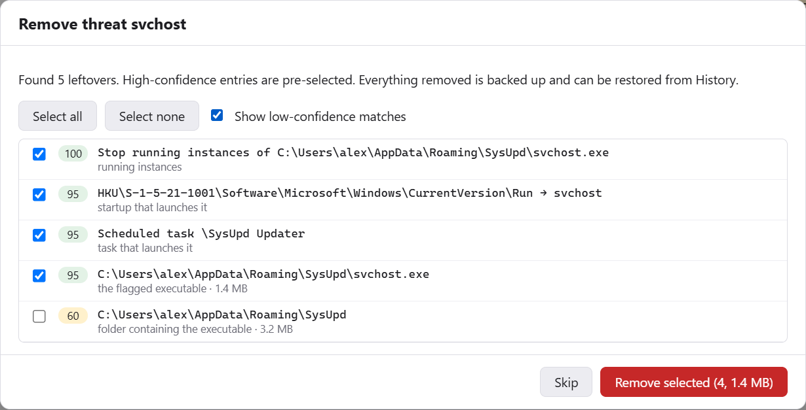
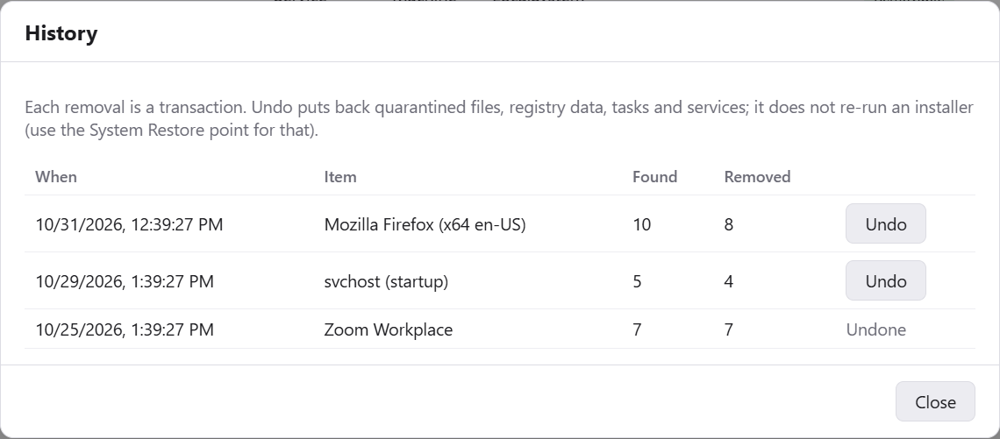
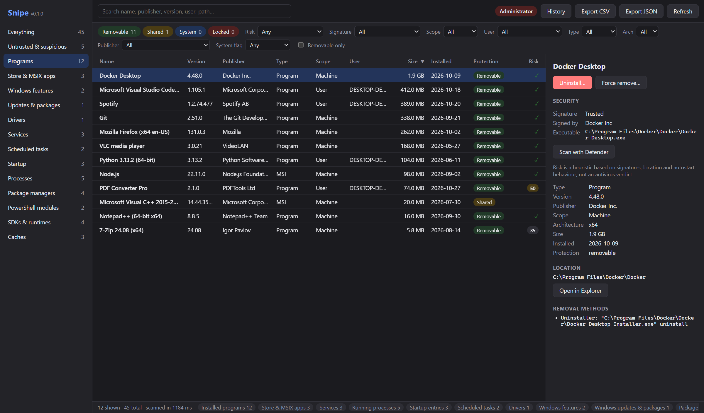

# Snipe

**Snipe** is a lightweight, fast Windows inventory and deep uninstaller. It lists everything that is installed or running on a PC — classic programs, MSI products, Store/MSIX apps, Windows features and updates, drivers, services, scheduled tasks, startup entries, processes, package-manager packages, PowerShell modules, SDKs, runtimes and caches — flags untrusted or suspicious software, and removes things **completely**: it runs the vendor uninstaller and then finds and cleans the files, folders and registry entries left behind, with backups and one-click undo.

Built with Rust and [Tauri 2](https://tauri.app) (WebView2) and a Svelte 5 UI. The installer is a few MB, and a full scan takes a few seconds.

**Website:** [arteficent.github.io/snipe](https://arteficent.github.io/snipe/) · **Download:** [latest release](https://github.com/arteficent/snipe/releases/latest)



> [!WARNING]
> Snipe deletes software, files and registry data with administrator rights. Every removal is previewed, backed up and can be undone from **History**. Even so, review what you select, and test on a virtual machine before relying on it.

## Screenshots

| Untrusted & suspicious software | Uninstall plan |
|---|---|
|  |  |
| **Leftover review** | **Remove threat** |
|  |  |
| **History & undo** | **Dark mode** |
|  |  |

The screenshots use fictional demo data. To regenerate them, see [Updating screenshots](#updating-screenshots).

## Features

- **Complete inventory.** Each source is a parallel collector, and results stream into the UI as each collector finishes:
  - Win32 and MSI programs, read from HKLM (both registry views) and every loaded user hive.
  - AppX/MSIX packages, services, processes (with owner), scheduled tasks, startup entries and third-party drivers.
  - Windows features, capabilities and servicing packages. These are read with DISM and need an admin session.
  - Packages from Chocolatey, Scoop, npm, pip, cargo and dotnet tools.
  - PowerShell modules.
  - SDKs and runtimes: .NET, Python, Windows SDK, Java, Rust toolchains, Visual Studio, Node versions and the Android SDK.
  - Developer and temp caches, with their sizes.
- **Filters.** You can filter by protection level, scope, user, type, architecture, publisher, package manager, system flag, risk and signature, and use instant search.
- **Untrusted software detection.**
  - Snipe verifies Authenticode signatures: embedded signatures and Windows catalogs, checked offline.
  - It also applies heuristics: self-signed or tampered signatures, files in temp or user folders, imitation Windows system file names, double extensions, hidden files, encoded PowerShell or remote downloads at startup.
  - Each item gets a risk score, and the "Untrusted & suspicious" view lists everything that scores 40 or more.
  - **Remove threat** stops the running instances, removes the startup entries, tasks and services that launch the file, and quarantines it.
  - **Scan with Defender** gets a Microsoft Defender verdict for a single file.
- **Deep uninstall.**
  - Snipe creates a restore point, closes running processes, then runs the uninstaller (MSI, Win32, AppX, DISM, pnputil or a package manager). Uninstallers run inside a job object, and Inno Setup and NSIS uninstallers can run silently.
  - It then scans for leftovers and scores each one by confidence. You review the list, and selected items are removed with backup.
  - **Force remove** handles programs whose uninstaller is broken or missing.
- **Safety.**
  - A hard deny-list protects Windows paths and registry keys.
  - Removed files are moved to quarantine instead of deleted, and registry data is exported to `.reg` backups.
  - Each removal is recorded as a transaction with an **Undo** in History.
  - Files that are in use are deleted at the next restart.
  - Backups are purged after 30 days.
- **Least privilege.**
  - The UI runs as a standard user. An elevated broker is started on demand through UAC.
  - The broker is reached over an access-controlled named pipe and only accepts item IDs, never paths or commands.
  - Uninstallers registered by a single user always run without elevation.
- **Extras.** CSV/JSON export, a cached inventory for instant start-up, and a headless CLI.

## Installing

Download the latest `Snipe_<version>_x64-setup.exe` (64-bit) or `Snipe_<version>_x86-setup.exe` (32-bit) from [Releases](https://github.com/arteficent/snipe/releases) and run it. The installer is standalone: it installs for the current user and downloads the WebView2 runtime if it is missing (Windows 10/11 already include it).

## Using Snipe

1. Start **Snipe**. The inventory loads from the cache, then refreshes.
2. Choose a category in the sidebar, and narrow it down with search and the filter bar.
3. Select an item to see its details, signature, risk, location and removal methods.
4. **Uninstall…** walks you through the plan, runs the uninstaller, then shows the leftovers it found so you can review them. High-confidence leftovers are pre-selected.
5. **Admin session** elevates once, through UAC, so Snipe can scan Windows features and updates and perform removals.
6. **History** lists past removals. **Undo** restores quarantined files, registry data, tasks and services. Use the System Restore point to roll back an uninstaller itself.

### Command-line interface

```powershell
snipe-cli scan                         # scan and print a summary per collector
snipe-cli list chrome                  # list items (with ids) matching "chrome"
snipe-cli threats [min-score]          # untrusted / suspicious items
snipe-cli plan <id>                    # uninstall plan (no changes)
snipe-cli leftovers <id>               # dry-run leftover scan (no changes)
snipe-cli export --format csv --out inventory.csv
snipe-cli --version
```

## Building from source

### Prerequisites

| Tool | Version |
|------|---------|
| Windows | 10 or 11 (x64 or x86) |
| [Rust](https://rustup.rs) | via rustup; the toolchain is pinned in `rust-toolchain.toml` and installed automatically (MSVC) |
| Visual Studio Build Tools | "Desktop development with C++" workload |
| [Node.js](https://nodejs.org) | 20 or newer |
| WebView2 Runtime | Included with Windows 10/11 |

### Build

```powershell
git clone https://github.com/arteficent/snipe.git
cd snipe/app
npm ci
npm run tauri build -- --bundles nsis          # installer in target/release/bundle/nsis/
```

To build the 32-bit installer, run `rustup target add i686-pc-windows-msvc` and then `npm run tauri build -- --target i686-pc-windows-msvc --bundles nsis`.

The CLI alone: `cargo build --release -p snipe-cli` produces `target/release/snipe-cli.exe`.

### Run and debug

```powershell
cd app
npm run tauri dev        # Vite dev server + debug build with hot reload of the UI
```

- In debug builds the Rust process keeps its console, so `eprintln!` output and panics are visible. Set `RUST_BACKTRACE=1` to get backtraces.
- Open the WebView developer tools with `Ctrl+Shift+I` (or right-click → Inspect).
- To debug Rust in VS Code, install the *rust-analyzer* and *CodeLLDB* (or *C/C++*) extensions. Start `npm run dev` in `app/`, then launch `target/debug/snipe.exe` under the debugger.
- **Privileged code paths.** The broker runs in a separate elevated process (`snipe.exe --broker <pipe> <pid>`). For easy debugging, start VS Code or the terminal *as administrator*. Snipe then detects that it is elevated and runs the engine in-process, so breakpoints in `snipe-engine` are hit directly.
- Quick collector check: `cargo run -p snipe-collectors --example scan --release`.

### Test and lint

```powershell
cargo test --workspace
cargo clippy --workspace --all-targets -- -D warnings
cd app; npm run check; npm run build
```

### Updating screenshots

Screenshots are taken in a normal browser with fictional demo data, so they never show a real machine.
[`scripts/screenshots/mock-ipc.js`](scripts/screenshots/mock-ipc.js) stands in for the Tauri backend.

1. Copy the mock into Vite's public folder: `mkdir app/public; cp scripts/screenshots/mock-ipc.js app/public/__mock-ipc.js`.
2. Start the dev server: `cd app; npm run dev`.
3. Open <http://localhost:5173> in a browser automation tool (for example Playwright). Before the page loads, inject the mock with an init script that loads `/__mock-ipc.js` synchronously.
4. Save screenshots to `docs/images/`, then delete `app/public/`.

### Website

The product page is a single static file, [`docs/index.html`](docs/index.html), which uses the images in `docs/images/`. To publish it, open the repository **Settings → Pages** and set **Source** to *Deploy from a branch*, then choose `main` and the `/docs` folder. The site appears at <https://arteficent.github.io/snipe/>.

## Project layout

```
crates/
  snipe-core/        Item model, collector trait, deny-list, command-line parsing, risk heuristics
  snipe-collectors/  One module per inventory source + Authenticode verification
  snipe-engine/      Uninstall orchestration, leftover scanner, safety layer, broker, cache, export
  snipe-cli/         Headless CLI
app/                 Svelte 5 frontend (Vite)
app/src-tauri/       Tauri shell and commands
scripts/version.mjs  Versioning helper
scripts/screenshots/ Demo-data mock used for screenshots
docs/                Website (index.html), screenshots, architecture and plan
graphify-out/        Knowledge graph of the codebase (see GRAPH_REPORT.md)
```

See [docs/ARCHITECTURE_AND_PLAN.md](docs/ARCHITECTURE_AND_PLAN.md) for the design.

## Versioning and releases

Snipe follows [Semantic Versioning](https://semver.org). The single source of truth is `version` in `[workspace.package]` of the root `Cargo.toml`. The crates, the Tauri bundle and `app/package.json` all follow it.

```powershell
node scripts/version.mjs current          # print the current version
node scripts/version.mjs next             # next version from commits since the last tag
node scripts/version.mjs set 1.2.3        # update Cargo.toml, Cargo.lock and package files
```

Commit messages follow [Conventional Commits](https://www.conventionalcommits.org):

- `feat:` creates a minor release.
- `fix:` and other types create a patch release.
- `feat!:` or a `BREAKING CHANGE` footer creates a major release (a minor release while the version is still 0.x).

### CI/CD

- **Pull requests** ([`.github/workflows/pr.yml`](.github/workflows/pr.yml)) build and test only what the PR changed:
  - Changed Rust crates are compiled, linted and tested together with the crates that depend on them.
  - Frontend changes are type-checked and built.
- **Releases** ([`.github/workflows/release.yml`](.github/workflows/release.yml)) run on every push to `main`, or manually with a chosen bump. Each run:
  1. Computes the next version.
  2. Builds standalone NSIS installers for x64 and x86.
  3. Commits the version bump, tags `vX.Y.Z` and publishes a GitHub release with both installers.

  If `main` is protected, allow GitHub Actions to push to it, or give the workflow a token that can.

## Contributing

Issues and pull requests are welcome. Please run the test and lint commands above before opening a PR, and use Conventional Commit messages.

## License

Licensed under either of

- Apache License, Version 2.0 ([LICENSE-APACHE](LICENSE-APACHE))
- MIT license ([LICENSE-MIT](LICENSE-MIT))

at your option.

Unless you explicitly state otherwise, any contribution intentionally submitted for inclusion in the work by you, as defined in the Apache-2.0 license, shall be dual licensed as above, without any additional terms or conditions.
