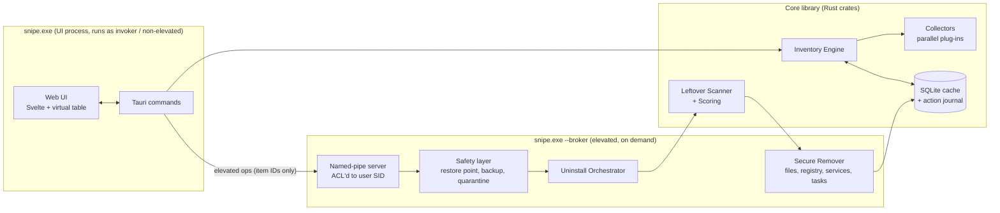

# Snipe — Windows Inventory & Deep Uninstaller

Architecture & Implementation Plan

---

## 1. Goals

| # | Goal | Notes |
|---|------|-------|
| G1 | **List everything installed** | Win32/MSI apps, Store/MSIX apps, Windows features & capabilities, drivers, services, running processes, package-manager packages, libraries, SDKs and runtimes. |
| G2 | **Uninstall with admin rights** | Run the vendor's uninstaller first, then fall back to forced removal. |
| G3 | **Remove every trace** | AppData, LocalAppData, ProgramData, temp, caches, shortcuts, registry keys, services, scheduled tasks, firewall rules, PATH entries, COM registrations, file associations. |
| G4 | **Lightweight and fast** | Small binary (< 15 MB), low idle RAM, first full scan in a few seconds, instant refresh from cache. |
| G5 | **Safe** | Never brick the OS. Every destructive action can be previewed, backed up and undone. |

### Non-goals (v1)
- Removing core Windows components that are protected by TrustedInstaller/WRP (System32, WinSxS, NonRemovable inbox apps). These are **listed but locked**.
- Antivirus/malware removal.
- Cross-platform support.

---

## 2. Technology Choice

### 2.1 Options compared

| Stack | Binary size | Idle RAM | Win32/COM/WinRT access | UI productivity | Verdict |
|-------|-------------|----------|------------------------|-----------------|---------|
| **Rust + Tauri 2 (WebView2)** | ~5–10 MB | ~40–80 MB | Excellent (`windows-rs`, official Microsoft crate) | High (any web UI) | **Recommended** |
| Rust + Slint / egui (pure native) | ~4–8 MB | ~15–30 MB | Excellent | Medium | Best if RAM matters most |
| C# .NET 8/9 + WinUI 3 / WPF | 60–150 MB self-contained (NativeAOT not supported by WPF/WinUI) | ~80–150 MB | Excellent (WMI, Registry, P/Invoke easy) | High | Good, but heavier |
| C++ Win32 / WTL | ~1–3 MB | ~10 MB | Native | Low (slow to build UI) | Too costly to develop |
| Go + Wails | ~10 MB | ~50 MB | Weak COM/WinRT support | High | Not ideal |
| Electron / Python | 100+ MB | 150+ MB | Indirect | High | Fails "lightweight" |

### 2.2 Recommendation

- **Core engine: Rust** (memory safe, no runtime or GC, true parallelism, first-class Windows bindings through the `windows` crate).
- **UI: Tauri 2** with **SvelteKit or SolidJS** plus a virtualized table, so 10k+ rows still scroll smoothly. WebView2 ships with Windows 10/11, so it adds nothing to the binary.
- **Storage: SQLite** (`rusqlite`, bundled) as the inventory cache and action journal.
- **Packaging: MSI or NSIS** through the Tauri bundler, Authenticode-signed (signing is required to avoid SmartScreen and AV false positives).

> If idle RAM must stay under ~30 MB, swap Tauri for **Slint**. The core crates do not change because the UI is a thin layer.

### 2.3 Key crates

| Purpose | Crate |
|---------|-------|
| Win32, COM, WinRT APIs | `windows` (windows-rs) |
| Registry convenience | `winreg` |
| Parallelism | `rayon` (CPU-bound scans), `tokio` (async IPC/process wait) |
| File walking | `jwalk` (parallel), `walkdir` |
| Fuzzy matching for leftovers | `strsim`, `aho-corasick` |
| Serialization | `serde`, `serde_json` |
| Cache / journal | `rusqlite` (bundled) |
| Quarantine archive | `zip` or `zstd` + `tar` |
| Logging | `tracing`, `tracing-appender` |
| Errors | `thiserror`, `anyhow` |

---

## 3. High-Level Architecture



### 3.1 Process & privilege model

- **One binary, two modes.** `snipe.exe` starts **non-elevated** so browsing and searching never needs UAC. The first time a privileged action is needed, it relaunches itself as `snipe.exe --broker` through `ShellExecuteEx` with `runas` (one UAC prompt per session).
- **IPC:** a named pipe whose DACL allows only the interactive user's SID. The broker checks the client's PID and image path with `GetNamedPipeClientProcessId`.
- **Requests carry item IDs, not paths or commands.** The broker re-resolves each ID against its own inventory. This prevents a compromised UI from asking it to delete arbitrary files.
- Enumerating other users' data requires `SeBackupPrivilege` / `SeRestorePrivilege` in the broker so it can load unloaded user hives (`RegLoadKey` on `NTUSER.DAT`).

---

## 4. Inventory Engine (Collectors)

Each source is a plug-in that implements one trait and runs in parallel. Results stream to the UI as soon as each collector finishes.

```rust
pub trait Collector: Send + Sync {
    fn id(&self) -> &'static str;
    fn requires_admin(&self) -> bool;
    fn fingerprint(&self) -> Option<u64>;            // cheap change detection
    fn collect(&self, ctx: &ScanContext) -> Result<Vec<Item>>;
}
```

### 4.1 Sources

| Category | Source / API | Notes |
|----------|--------------|-------|
| **Win32 apps** | `HKLM\SOFTWARE\Microsoft\Windows\CurrentVersion\Uninstall`, the same key under `WOW6432Node`, `HKCU\…\Uninstall`, and every loaded `HKU\<SID>` | Use `KEY_WOW64_64KEY` and `KEY_WOW64_32KEY` explicitly. Skip `SystemComponent=1` entries by default but keep them under a "hidden" filter. |
| **MSI products** | `MsiEnumProductsEx` / `MsiGetProductInfoEx` | **Never use WMI `Win32_Product`**: it is slow and triggers MSI self-repair on every product. |
| **Store / MSIX / AppX** | WinRT `Windows.Management.Deployment.PackageManager` (`FindPackagesForUser`, `FindPackages`), plus DISM `DismGetProvisionedAppxPackages` | Mark `SignatureKind=System` and `IsFramework` packages. Respect `NonRemovable`. |
| **Windows optional features** | DISM API `DismGetFeatures` | Remove by disabling the feature, not by deleting files. |
| **Capabilities (FoD)** | `DismGetCapabilities` | Examples: OpenSSH, language packs. |
| **Windows updates (KB)** | `DismGetPackages`, WUA `IUpdateSearcher` history | Uninstall through DISM only. |
| **Drivers** | `SetupDiGetClassDevs` and DISM `DismGetDrivers` (third-party only) | Remove through `DiUninstallDriver`. |
| **Services** | SCM `EnumServicesStatusExW` + `QueryServiceConfigW` | Link each service to its owning app by binary path. |
| **Processes** | `NtQuerySystemInformation(SystemProcessInformation)` (fastest), `QueryFullProcessImageNameW` | Flag critical processes (`IsProcessCritical`). Never kill those, because doing so causes a BSOD. |
| **Scheduled tasks** | Task Scheduler COM `ITaskService` | Link tasks to apps by action path. |
| **Startup entries** | `Run`/`RunOnce` keys, Startup folders, `StartupApproved` | |
| **winget** | COM `Microsoft.Management.Deployment` (out-of-proc); fallback `winget export` JSON | Shows packages that winget tracks. |
| **Chocolatey** | `%ChocolateyInstall%\lib\*\*.nuspec` | |
| **Scoop** | `%USERPROFILE%\scoop\apps\*\current\manifest.json` | |
| **npm / pnpm / yarn global** | `%APPDATA%\npm\node_modules`, pnpm store | Read `package.json` directly instead of shelling out. |
| **Python** | PEP 514 registry (`HKLM/HKCU\Software\Python`), `py -0p`, each interpreter's `site-packages\*.dist-info` | Covers every interpreter, conda envs and venvs (optional deep scan). |
| **pipx, cargo, go, gem, composer, dotnet tools** | Known install dirs (`~\.cargo\bin`, `%GOPATH%\bin`, `~\.dotnet\tools`, …) | |
| **.NET SDKs / runtimes** | `%ProgramFiles%\dotnet\sdk\*`, `shared\*\*`, plus `HKLM\SOFTWARE\dotnet\Setup\InstalledVersions` | |
| **Windows SDK / WDK** | `HKLM\SOFTWARE\Microsoft\Windows Kits\Installed Roots` | |
| **Visual Studio / Build Tools** | Setup Configuration COM (`ISetupConfiguration2`) | Same data source as `vswhere`. |
| **Java JDK / JRE** | `HKLM\SOFTWARE\JavaSoft`, Eclipse Adoptium / Azul / Microsoft keys, `JAVA_HOME` | |
| **Node versions** | nvm-windows, fnm, volta dirs | |
| **Android SDK, Flutter, Rustup toolchains** | `ANDROID_HOME`, `~\.rustup\toolchains` | |
| **VC++ redistributables** | Uninstall keys + `HKLM\SOFTWARE\Microsoft\VisualStudio\14.0\VC\Runtimes` | Mark as **shared dependency** and warn on removal. |
| **PowerShell modules** | Every path in `PSModulePath` | |
| **Dev caches** | NuGet, Maven `.m2`, Gradle, pip cache, npm cache | Shown under "Caches" with size and a clean action. |
| **Portable apps** (optional) | Heuristic scan of user-chosen folders for signed `.exe` files with version info | Off by default. |

### 4.2 Unified data model

```rust
pub struct Item {
    pub id: ItemId,                  // stable hash of (kind, source key, scope)
    pub kind: ItemKind,              // Win32 | Msi | Appx | Feature | Capability | Update
                                     // | Driver | Service | Process | Task | PkgMgr(Manager)
                                     // | Sdk | Runtime | Library | Cache
    pub name: String,
    pub version: Option<String>,
    pub publisher: Option<String>,
    pub install_location: Option<PathBuf>,
    pub install_date: Option<Date>,
    pub size_bytes: Option<u64>,
    pub scope: Scope,                // Machine | User(Sid)
    pub arch: Arch,                  // x64 | x86 | arm64 | neutral
    pub signer: Option<String>,      // Authenticode subject
    pub protection: Protection,      // Removable | Shared | SystemCritical | Locked
    pub uninstall: Vec<UninstallMethod>,
    pub related: Vec<ItemId>,        // services, tasks, processes owned by this item
    pub source_ref: SourceRef,       // raw key/path for traceability
}
```

### 4.3 Performance strategy

- **Run all collectors in parallel** with `rayon` and stream results to the UI through Tauri events.
- **Incremental refresh:** store each collector's fingerprint, for example registry key `LastWriteTime` from `RegQueryInfoKeyW` or directory mtimes. Re-run a collector only when its fingerprint changes.
- **Lazy size calculation:** read `EstimatedSize` first and compute real folder sizes in the background with `jwalk`.
- **No PowerShell or WMI in hot paths.** Call native APIs directly. Spawning a CLI is only a fallback.
- **Defer icon extraction:** load icons only for visible rows and cache them on disk.
- Target: a cold full scan finishes in a few seconds on an SSD, and a warm start renders from SQLite almost instantly.

---

## 5. Uninstall Pipeline

```mermaid
flowchart TD
    A[User selects item(s)] --> B[Preflight]
    B -->|protected / critical| X[Block with explanation]
    B --> C[Safety snapshot<br/>restore point + pre-scan]
    C --> D[Stop owning processes & services<br/>Restart Manager API]
    D --> E{Uninstall method}
    E -->|MSI| E1[msiexec /x {GUID} /qn]
    E -->|Win32| E2[QuietUninstallString or UninstallString<br/>inside a Job Object]
    E -->|AppX| E3[PackageManager.RemovePackageAsync<br/>+ deprovision]
    E -->|Feature/Capability/Update| E4[DISM API]
    E -->|Pkg manager| E5[winget / choco / scoop / npm / pip uninstall]
    E -->|Broken / missing uninstaller| E6[Forced removal]
    E1 & E2 & E3 & E4 & E5 & E6 --> F[Verify removal]
    F --> G[Leftover scan + scoring]
    G --> H[User review<br/>high-confidence items pre-checked]
    H --> I[Backup: .reg export + file quarantine]
    I --> J[Delete<br/>locked files: delete on reboot]
    J --> K[Journal + refresh inventory]
```

### 5.1 Details

1. **Preflight**
   - Check the protection level and block `SystemCritical` and `Locked` items.
   - Run a dependency check: VC++ / .NET runtimes, `SharedDLLs` reference counts, AppX framework dependents, and other apps whose files reference this install location.
2. **Safety snapshot**: call `SRSetRestorePoint` (rate-limited by Windows to once per 24 h unless the registry override is set; show a warning when it is skipped).
3. **Stop processes**: use the Restart Manager (`RmStartSession`, `RmRegisterResources`, `RmGetList`) to find every process that locks the install directory, then close gracefully before terminating.
4. **Run the uninstaller**
   - Parse `UninstallString` with `CommandLineToArgvW`. **Never** pass it to `cmd /c` (that would allow command injection).
   - Launch the process inside a **Job Object** so the orchestrator waits for child processes too. Many uninstallers spawn a copy of themselves in `%TEMP%` and exit early.
   - Prefer silent switches: `QuietUninstallString`, MSI `/qn`, or known installer families (Inno Setup `/VERYSILENT`, NSIS `/S`, InstallShield). If silent mode is unknown, run interactively.
5. **Forced removal** (when the uninstaller is broken or missing): skip straight to leftover removal using the install location and registry data.

---

## 6. Leftover ("Trace") Scanner

### 6.1 Locations scanned (for every user profile)

**File system**
- `InstallLocation`, `%ProgramFiles%`, `%ProgramFiles(x86)%`, `%ProgramData%`
- `%APPDATA%`, `%LOCALAPPDATA%`, `%USERPROFILE%\AppData\LocalLow`
- `%LOCALAPPDATA%\Packages\<PFN>` (AppX data)
- `%TEMP%`, `%WINDIR%\Temp`
- Start Menu (all users and per user), Desktop, Quick Launch, Taskbar pins
- `%LOCALAPPDATA%\Programs`, `%LOCALAPPDATA%\<Vendor>`
- `%ProgramData%\Package Cache\{GUID}`, orphaned `%WINDIR%\Installer\*.msi`/`*.msp` (only when no product references them)
- Crash dumps: `%LOCALAPPDATA%\CrashDumps\<exe>*`

**Registry**
- `HKLM/HKCU\SOFTWARE\<Publisher>\<Product>` (both views)
- Uninstall key, `App Paths`, `Installer\Products`, `Installer\UserData\…\Products`
- `HKCR` ProgIDs, file extensions, `CLSID`/`TypeLib`/`Interface` whose `InprocServer32` or `LocalServer32` points into the install dir
- Shell extensions (context menus, `ShellIconOverlayIdentifiers`)
- `Run`/`RunOnce`, `StartupApproved`
- `SharedDLLs` entries with references in the install dir
- Firewall rules (`INetFwPolicy2`), services (`DeleteService`), scheduled tasks (`ITaskFolder::DeleteTask`)
- `PATH` and other environment variables (machine and user) that contain the install dir, followed by a `WM_SETTINGCHANGE` broadcast
- `MuiCache`, `AppCompatFlags\Compatibility Assistant\Store` (cosmetic, low priority)

### 6.2 Matching & confidence scoring

Each candidate gets a score from 0 to 100:

| Signal | Weight |
|--------|--------|
| Path is inside the known `InstallLocation` | +60 |
| Registry value data references the install path | +50 |
| Folder/key name exactly matches product name or publisher+product | +40 |
| File signed by the same Authenticode signer | +30 |
| Fuzzy name similarity (Jaro-Winkler ≥ 0.9) | +20 |
| Created within ±N minutes of `InstallDate` | +10 |
| Name matches only the **publisher** (for example `Microsoft`, `Google`) | −40 (shared vendor folder) |
| Referenced by another installed product | −100 (excluded) |

- ≥ 80: pre-selected. 50–79: shown, unchecked. < 50: hidden behind "Show more".
- A **deny-list** is always enforced: `%WINDIR%`, `System32`, `SysWOW64`, `WinSxS`, `%ProgramFiles%` root, user profile roots, `HKLM\SYSTEM\CurrentControlSet\Control`, `HKCR\*` root, and other critical paths.

### 6.3 Install tracing (Phase 5, optional)

This works like Revo's "traced install": while a new installer runs, record file and registry changes through **ETW** (Kernel File + Registry providers) or a before/after snapshot diff. Store the exact trace and use it later for removal that matches 100%.

---

## 7. Safety Layer

| Mechanism | Implementation |
|-----------|----------------|
| Dry run | Every action produces a plan (JSON) that is shown before execution. |
| System Restore point | `SRSetRestorePoint` before each uninstall batch. |
| Registry backup | Export affected keys to `.reg` (`RegSaveKeyEx` or a custom writer) in `%ProgramData%\Snipe\backups\<txn>`. |
| File quarantine | **Move** files to `%ProgramData%\Snipe\quarantine\<txn>` with a manifest, then compress in the background. Purge after N days (configurable). |
| Undo | Restore from the quarantine plus the `.reg` import for a whole transaction. |
| Journal | Each step is written to SQLite *before* and *after* it runs, so the operation can resume or roll back after a crash. |
| Locked files | `MoveFileExW(MOVEFILE_DELAY_UNTIL_REBOOT)`, and the UI shows "reboot required". |
| Reparse points | **Never follow** junctions or symlinks during deletion. Delete the link, not the target (prevents deleting `C:\` through a junction). |
| Long paths | Always use the `\\?\` prefix. |
| WOW64 | Use explicit registry views and resolve `Sysnative` for 32-bit paths. |
| OneDrive / cloud placeholders | Detect `FILE_ATTRIBUTE_RECALL_ON_DATA_ACCESS` and skip, to avoid triggering downloads. |
| Protected items | TrustedInstaller-owned files, `NonRemovable` AppX packages and critical processes are shown as **Locked**. The app never takes ownership of system files. |

---

## 8. Security Requirements

- Make the broker accept **item IDs only**. It re-derives every path and command itself and never trusts paths sent by the UI.
- Canonicalize all paths (`GetFinalPathNameByHandleW`) and check them against the deny-list **after** resolution (prevents TOCTOU and `..` tricks).
- Do not concatenate shell strings. Use `CreateProcessW` with parsed arguments.
- Lock the named pipe DACL to the current user SID and verify the client image path.
- Sign the binaries. Do not download or execute remote code. Updates must be signature-verified.
- Keep logs free of user secrets. Use `tracing` with log rotation.
- Set the Tauri CSP to strict and allowlist only the commands the UI needs.

---

## 9. Project Structure

```
snipe/
├─ Cargo.toml                 # workspace
├─ crates/
│  ├─ snipe-core/             # Item model, collector trait, deny-list, command-line parsing, path utils
│  ├─ snipe-collectors/       # one module per source (registry, appx, dism, drivers, tasks, packages, sdks, caches…)
│  ├─ snipe-engine/           # uninstall orchestration, leftover scanner, safety (txn/backup/quarantine/undo),
│  │                          # inventory cache, export, elevated broker (named pipe) + protocol
│  └─ snipe-cli/              # headless CLI (scan/list/export, dry-run plan & leftovers)
├─ app/                      # Vite + Svelte 5 frontend root (package.json, index.html)
│  ├─ src/                    # UI: virtual table, filters, details pane
│  └─ src-tauri/              # Tauri shell, commands, broker launcher
├─ tests/
│  ├─ fixtures/               # sample registry exports, manifests
│  └─ sandbox/                # .wsb configs + scripts for Windows Sandbox E2E runs
└─ docs/
   └─ ARCHITECTURE_AND_PLAN.md
```

---

## 10. UI Overview

- **Left nav:** All • Apps • Store Apps • Windows Features • Updates • Drivers • Services • Processes • Startup • Dev SDKs & Runtimes • Packages (per manager) • Caches • Locked/System
- **Main table (virtualized):** name, version, publisher, size, install date, scope, source, protection badge
- **Search:** instant fuzzy filter across all columns
- **Details pane:** install path, uninstall command, related services/tasks/processes, dependencies, registry source
- **Actions:** Uninstall • Force remove • Open location • Kill process • Disable startup • Export (CSV/JSON)
- **Review dialog:** tree of leftover files and registry entries with confidence scores and checkboxes
- **History:** past transactions, each with **Undo**

---

## 11. Implementation Plan (Phases)

| Phase | Scope | Exit criteria |
|-------|-------|---------------|
| **0. Spike** | Cargo workspace, Tauri shell, `windows-rs` registry + MSI enumeration, one virtual table | Lists Win32 + MSI apps in a table, binary < 10 MB |
| **1. Core inventory (read-only)** | Uninstall keys (all views and users), MSI, AppX, services, processes, startup, scheduled tasks; SQLite cache; fingerprints; search and filters | Matches *Settings → Apps* count ±5%; warm start renders instantly |
| **2. Extended inventory** | DISM features, capabilities, updates, drivers; winget, choco, scoop, npm, pip, cargo, dotnet tools; SDK detectors (.NET, Windows SDK, VS, JDK, Python, Node, Android, Rust); caches | All sources visible with correct protection flags |
| **3. Elevated broker + uninstall** | Broker IPC, preflight, restore point, Restart Manager, Job Objects, MSI, Win32, AppX, DISM and package-manager uninstall | Uninstalls a test set of 20+ popular apps silently in Windows Sandbox |
| **4. Leftover cleaner + safety** | Trace scanner, scoring, review UI, `.reg` backup, quarantine, undo, delete-on-reboot | After uninstall + clean, a fresh scan finds no trace of the test apps; undo fully restores them |
| **5. Advanced** | Forced removal of broken entries, install tracing (ETW), CLI, export, scheduled cache cleanup | Feature-complete |
| **6. Hardening & release** | Fuzz the uninstall-string parser, security review, code signing, installer, auto-update with signature check | Signed release; no AV false positives on major engines |

### 11.1 Implementation status

| Area | Status |
|------|--------|
| Inventory | Done: Win32/MSI (HKLM both views + every loaded `HKU\<SID>`), AppX, services, processes (with owner), scheduled tasks (COM), startup (all users), drivers (`oem*.inf`), Windows features / capabilities / packages (`dism.exe`, admin only), Chocolatey, Scoop, npm, pip, cargo, dotnet tools, PowerShell modules, .NET / Python / Windows SDK / Java / Rust / Visual Studio / Node / Android SDKs, caches with sizes. |
| Cache | Done: JSON snapshot in `%LOCALAPPDATA%\Snipe\inventory.json` (SQLite and per-collector fingerprints are deferred). |
| Broker | Done: on-demand UAC elevation, ACL'd named pipe with medium-IL label, client/server PID + image checks, ID-only requests. |
| Uninstall | Done: MSI, Win32 (job object, Inno/NSIS silent switches), AppX, services, drivers (`pnputil`), DISM features/capabilities/packages, package managers, tasks, startup entries, cache cleaning; user-scope uninstallers run unelevated; process shutdown via Toolhelp (Restart Manager deferred). |
| Leftovers & safety | Done: scanner + scoring, deny-list, review UI, restore point, `.reg` backups, quarantine, task XML backup, PATH edits, delete-on-reboot, journaled transactions, undo, 30-day purge, protected `%ProgramData%\Snipe` ACL. |
| Advanced | Done: force removal, CLI, CSV/JSON export. Deferred: ETW install tracing, offline user hives (`RegLoadKey`). |
| Untrusted software | Done: Authenticode verification (embedded + Windows catalogs, offline) for programs, processes, services (incl. svchost `ServiceDll`), startup entries and tasks; AppX package signature kind; heuristic risk score (unsigned / self-signed / tampered, user-writable or temp location, system-name masquerading, double extensions, hidden files, encoded or remote-download autostart commands); "Untrusted & suspicious" view, Risk/Signature filters, "Remove threat" (stop instances, remove autostart entries, quarantine file — undoable) and on-demand Microsoft Defender file scan. Heuristic only; not a replacement for antivirus. |
| Hardening | Done: parser fuzz test, deny-list tests. Requires external setup: code signing certificate, update server/signing keys, AV vendor submission. |

---

## 12. Testing Strategy

- **Unit tests:** uninstall-string parsing, scoring, deny-list and path canonicalization (including junction and `..` attacks).
- **Fixture tests:** recorded registry exports and folder trees fed through the collectors.
- **E2E in Windows Sandbox / Hyper-V checkpoints:** a script installs a known app set (7-Zip, VLC, Notepad++, Git, Node, Python, VS Code, Chrome, Zoom, a Store app) with winget, runs Snipe uninstall + clean, then diffs the system against the pre-install snapshot.
- **Performance benchmarks:** cold and warm scan time and peak RAM, tracked in CI.

---

## 13. Key Risks & Mitigations

| Risk | Mitigation |
|------|------------|
| Deleting shared files breaks other apps | Dependency and `SharedDLLs` checks, publisher-only matches penalized, review step, quarantine and undo |
| Removing system components bricks Windows | Hard deny-list, `Locked` protection level, restore point, no TrustedInstaller ownership takeover |
| Uninstallers hang or need UI | Job Object with timeout, fall back to interactive mode, user can cancel |
| AV flags the tool (it deletes files, kills processes, edits registry) | Code signing, no obfuscation, no remote code, submit binaries to AV vendors |
| Other users' data not visible | Load offline hives with backup/restore privileges, then unload cleanly |
| Inaccurate package-manager data | Prefer each manager's own metadata files and cross-link with uninstall keys by install path |
