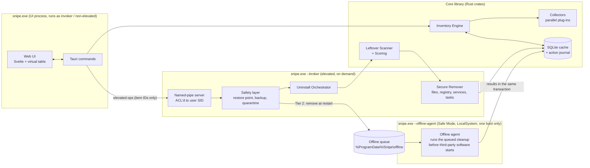
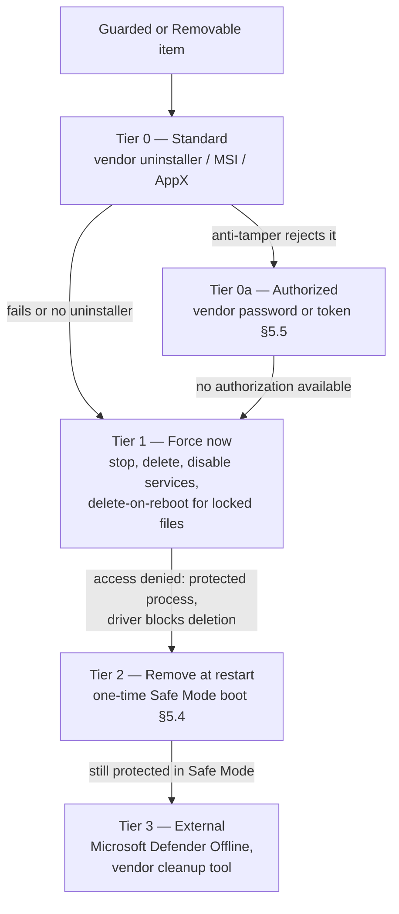
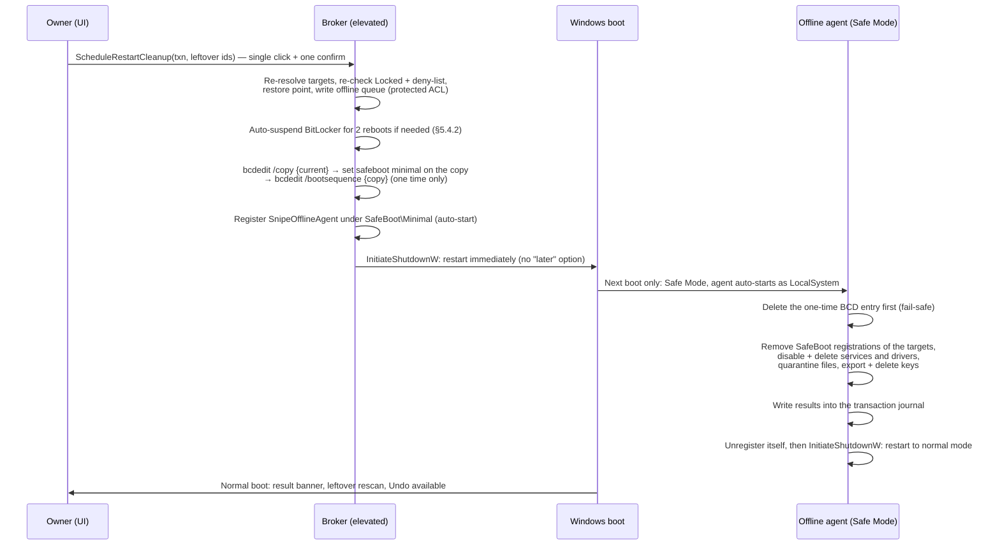

# Snipe — Windows Inventory & Deep Uninstaller

Architecture & Implementation Plan

---

## 1. Goals

| # | Goal | Notes |
|---|------|-------|
| G1 | **List everything installed** | Win32/MSI apps, Store/MSIX apps, Windows features & capabilities, drivers, services, running processes, package-manager packages, libraries, SDKs and runtimes. |
| G2 | **Uninstall with admin rights** | Run the vendor's uninstaller first, then fall back to forced removal. |
| G3 | **Remove every trace** | AppData, LocalAppData, ProgramData, temp, caches, shortcuts, registry keys, services, scheduled tasks, firewall rules, PATH entries, COM registrations, file associations. |
| G4 | **Lightweight and fast** | Small binary (< 15 MB), low idle RAM, first full scan in a few seconds, instant refresh from cache. |
| G5 | **Safe** | Never brick the OS. Every destructive action can be previewed, backed up and undone. |
| G6 | **Owner control** | The owner of the machine decides what stays. Any third-party software, including software that protects itself (anti-tamper agents, protected processes, malware), can be removed through a warned escalation path that ends in a cleanup at restart (§5.3). Only Windows-owned items whose removal leaves Windows unbootable stay locked. |

### Non-goals
- Removing Windows-owned components: TrustedInstaller-owned or WRP-protected files, critical processes, servicing-stack foundation packages. These are **listed but locked**. Supported Windows components (features, capabilities, updates, removable inbox apps) are removed only through their supported mechanisms.
- A kernel-mode driver, or any technique that disables the protection of a **running** process (protected processes, anti-tamper drivers). Such a driver is indistinguishable from an "EDR killer", would be flagged by every security product and cannot be signed by Microsoft. Self-protecting software is instead removed with its vendor's authorization or at restart, before its protection loads (§5.3).
- Replacing an antivirus. Snipe removes what the owner chooses; its threat detection is heuristic (§11.1).
- Cross-platform support.

---

## 2. Technology Choice

### 2.1 Options compared

| Stack | Binary size | Idle RAM | Win32/COM/WinRT access | UI productivity | Verdict |
|-------|-------------|----------|------------------------|-----------------|---------|
| **Rust + Tauri 2 (WebView2)** | ~5–10 MB | ~40–80 MB | Excellent (`windows-rs`, official Microsoft crate) | High (any web UI) | **Recommended** |
| Rust + Slint / egui (pure native) | ~4–8 MB | ~15–30 MB | Excellent | Medium | Best if RAM matters most |
| C# .NET 8/9 + WinUI 3 / WPF | 60–150 MB self-contained (NativeAOT not supported by WPF/WinUI) | ~80–150 MB | Excellent (WMI, Registry, P/Invoke easy) | High | Good, but heavier |
| C++ Win32 / WTL | ~1–3 MB | ~10 MB | Native | Low (slow to build UI) | Too costly to develop |
| Go + Wails | ~10 MB | ~50 MB | Weak COM/WinRT support | High | Not ideal |
| Electron / Python | 100+ MB | 150+ MB | Indirect | High | Fails "lightweight" |

### 2.2 Recommendation

- **Core engine: Rust** (memory safe, no runtime or GC, true parallelism, first-class Windows bindings through the `windows` crate).
- **UI: Tauri 2** with **SvelteKit or SolidJS** plus a virtualized table, so 10k+ rows still scroll smoothly. WebView2 ships with Windows 10/11, so it adds nothing to the binary.
- **Storage: SQLite** (`rusqlite`, bundled) as the inventory cache and action journal.
- **Packaging: MSI or NSIS** through the Tauri bundler, Authenticode-signed (signing is required to avoid SmartScreen and AV false positives).

> If idle RAM must stay under ~30 MB, swap Tauri for **Slint**. The core crates do not change because the UI is a thin layer.

### 2.3 Key crates

| Purpose | Crate |
|---------|-------|
| Win32, COM, WinRT APIs | `windows` (windows-rs) |
| Registry convenience | `winreg` |
| Parallelism | `rayon` (CPU-bound scans), `tokio` (async IPC/process wait) |
| File walking | `jwalk` (parallel), `walkdir` |
| Fuzzy matching for leftovers | `strsim`, `aho-corasick` |
| Serialization | `serde`, `serde_json` |
| Cache / journal | `rusqlite` (bundled) |
| Quarantine archive | `zip` or `zstd` + `tar` |
| Logging | `tracing`, `tracing-appender` |
| Errors | `thiserror`, `anyhow` |

---

## 3. High-Level Architecture



### 3.1 Process & privilege model

- **One binary, two modes.** `snipe.exe` starts **non-elevated** so browsing and searching never needs UAC. The first time a privileged action is needed, it relaunches itself as `snipe.exe --broker` through `ShellExecuteEx` with `runas` (one UAC prompt per session).
- **IPC:** a named pipe whose DACL allows only the interactive user's SID. The broker checks the client's PID and image path with `GetNamedPipeClientProcessId`.
- **Requests carry item IDs, not paths or commands.** The broker re-resolves each ID against its own inventory. This prevents a compromised UI from asking it to delete arbitrary files.
- Enumerating other users' data requires `SeBackupPrivilege` / `SeRestorePrivilege` in the broker so it can load unloaded user hives (`RegLoadKey` on `NTUSER.DAT`).
- **Third mode, `snipe.exe --offline-agent`** (Phase 7). It exists only for one Safe Mode boot that the owner scheduled, runs as a LocalSystem service registered under `SafeBoot\Minimal`, executes the queued transaction and then removes itself (§5.4). Snipe never installs a kernel driver.

---

## 4. Inventory Engine (Collectors)

Each source is a plug-in that implements one trait and runs in parallel. Results stream to the UI as soon as each collector finishes.

```rust
pub trait Collector: Send + Sync {
    fn id(&self) -> &'static str;
    fn requires_admin(&self) -> bool;
    fn fingerprint(&self) -> Option<u64>;            // cheap change detection
    fn collect(&self, ctx: &ScanContext) -> Result<Vec<Item>>;
}
```

### 4.1 Sources

| Category | Source / API | Notes |
|----------|--------------|-------|
| **Win32 apps** | `HKLM\SOFTWARE\Microsoft\Windows\CurrentVersion\Uninstall`, the same key under `WOW6432Node`, `HKCU\…\Uninstall`, and every loaded `HKU\<SID>` | Use `KEY_WOW64_64KEY` and `KEY_WOW64_32KEY` explicitly. Skip `SystemComponent=1` entries by default but keep them under a "hidden" filter. |
| **MSI products** | `MsiEnumProductsEx` / `MsiGetProductInfoEx` | **Never use WMI `Win32_Product`**: it is slow and triggers MSI self-repair on every product. |
| **Store / MSIX / AppX** | WinRT `Windows.Management.Deployment.PackageManager` (`FindPackagesForUser`, `FindPackages`), plus DISM `DismGetProvisionedAppxPackages` | Mark `SignatureKind=System` and `IsFramework` packages. Respect `NonRemovable`. |
| **Windows optional features** | DISM API `DismGetFeatures` | Remove by disabling the feature, not by deleting files. |
| **Capabilities (FoD)** | `DismGetCapabilities` | Examples: OpenSSH, language packs. |
| **Windows updates (KB)** | `DismGetPackages`, WUA `IUpdateSearcher` history | Uninstall through DISM only. |
| **Drivers** | `SetupDiGetClassDevs` and DISM `DismGetDrivers` (third-party only) | Remove through `DiUninstallDriver`. |
| **Services** | SCM `EnumServicesStatusExW` + `QueryServiceConfigW` | Link each service to its owning app by binary path. Phase 7 adds `SERVICE_DRIVER` (kernel and file-system drivers, including non-PnP minifilters that `oem*.inf` does not cover). An unreadable configuration means **Guarded**, not "Windows". |
| **Processes** | `NtQuerySystemInformation(SystemProcessInformation)` (fastest), `QueryFullProcessImageNameW` | Flag critical processes (`IsProcessCritical`). Never kill those, because doing so causes a BSOD. When `OpenProcess` is denied, resolve the image with `SystemProcessIdInformation` (no handle needed) and read the protection level with `GetProcessInformation(ProcessProtectionLevelInfo)`. Access denied means **Guarded**, not "Windows". |
| **Scheduled tasks** | Task Scheduler COM `ITaskService` | Link tasks to apps by action path. |
| **Startup entries** | `Run`/`RunOnce` keys, Startup folders, `StartupApproved` | |
| **winget** | COM `Microsoft.Management.Deployment` (out-of-proc); fallback `winget export` JSON | Shows packages that winget tracks. |
| **Chocolatey** | `%ChocolateyInstall%\lib\*\*.nuspec` | |
| **Scoop** | `%USERPROFILE%\scoop\apps\*\current\manifest.json` | |
| **npm / pnpm / yarn global** | `%APPDATA%\npm\node_modules`, pnpm store | Read `package.json` directly instead of shelling out. |
| **Python** | PEP 514 registry (`HKLM/HKCU\Software\Python`), `py -0p`, each interpreter's `site-packages\*.dist-info` | Covers every interpreter, conda envs and venvs (optional deep scan). |
| **pipx, cargo, go, gem, composer, dotnet tools** | Known install dirs (`~\.cargo\bin`, `%GOPATH%\bin`, `~\.dotnet\tools`, …) | |
| **.NET SDKs / runtimes** | `%ProgramFiles%\dotnet\sdk\*`, `shared\*\*`, plus `HKLM\SOFTWARE\dotnet\Setup\InstalledVersions` | |
| **Windows SDK / WDK** | `HKLM\SOFTWARE\Microsoft\Windows Kits\Installed Roots` | |
| **Visual Studio / Build Tools** | Setup Configuration COM (`ISetupConfiguration2`) | Same data source as `vswhere`. |
| **Java JDK / JRE** | `HKLM\SOFTWARE\JavaSoft`, Eclipse Adoptium / Azul / Microsoft keys, `JAVA_HOME` | |
| **Node versions** | nvm-windows, fnm, volta dirs | |
| **Android SDK, Flutter, Rustup toolchains** | `ANDROID_HOME`, `~\.rustup\toolchains` | |
| **VC++ redistributables** | Uninstall keys + `HKLM\SOFTWARE\Microsoft\VisualStudio\14.0\VC\Runtimes` | Mark as **shared dependency** and warn on removal. |
| **PowerShell modules** | Every path in `PSModulePath` | |
| **Dev caches** | NuGet, Maven `.m2`, Gradle, pip cache, npm cache | Shown under "Caches" with size and a clean action. |
| **Portable apps** (optional) | Heuristic scan of user-chosen folders for signed `.exe` files with version info | Off by default. |

### 4.2 Unified data model

```rust
pub struct Item {
    pub id: ItemId,                  // stable hash of (kind, source key, scope)
    pub kind: ItemKind,              // Win32 | Msi | Appx | Feature | Capability | Update
                                     // | Driver | Service | Process | Task | PkgMgr(Manager)
                                     // | Sdk | Runtime | Library | Cache
    pub name: String,
    pub version: Option<String>,
    pub publisher: Option<String>,
    pub install_location: Option<PathBuf>,
    pub install_date: Option<Date>,
    pub size_bytes: Option<u64>,
    pub scope: Scope,                // Machine | User(Sid)
    pub arch: Arch,                  // x64 | x86 | arm64 | neutral
    pub signer: Option<String>,      // Authenticode subject
    pub protection: Protection,      // Removable | Shared | System | Guarded | Locked (§5.2)
    pub uninstall: Vec<UninstallMethod>,
    pub related: Vec<ItemId>,        // services, tasks, processes owned by this item
    pub source_ref: SourceRef,       // raw key/path for traceability
}
```

### 4.3 Performance strategy

- **Run all collectors in parallel** with `rayon` and stream results to the UI through Tauri events.
- **Incremental refresh:** store each collector's fingerprint, for example registry key `LastWriteTime` from `RegQueryInfoKeyW` or directory mtimes. Re-run a collector only when its fingerprint changes.
- **Lazy size calculation:** read `EstimatedSize` first and compute real folder sizes in the background with `jwalk`.
- **No PowerShell or WMI in hot paths.** Call native APIs directly. Spawning a CLI is only a fallback.
- **Defer icon extraction:** load icons only for visible rows and cache them on disk.
- Target: a cold full scan finishes in a few seconds on an SSD, and a warm start renders from SQLite almost instantly.

---

## 5. Uninstall Pipeline

```mermaid
flowchart TD
    A[User selects item(s)] --> B[Preflight<br/>classify protection §5.2]
    B -->|Locked: Windows-owned| X[Block with explanation]
    B -->|Guarded: self-protecting| L[Removal ladder §5.3<br/>authorize, force, or remove at restart]
    B --> C[Safety snapshot<br/>restore point + pre-scan]
    C --> D[Stop owning processes & services<br/>Restart Manager API]
    D --> E{Uninstall method}
    E -->|MSI| E1[msiexec /x {GUID} /qn]
    E -->|Win32| E2[QuietUninstallString or UninstallString<br/>inside a Job Object]
    E -->|AppX| E3[PackageManager.RemovePackageAsync<br/>+ deprovision]
    E -->|Feature/Capability/Update| E4[DISM API]
    E -->|Pkg manager| E5[winget / choco / scoop / npm / pip uninstall]
    E -->|Broken / missing uninstaller| E6[Forced removal]
    E1 & E2 & E3 & E4 & E5 & E6 --> F[Verify removal]
    F --> G[Leftover scan + scoring]
    G --> H[User review<br/>high-confidence items pre-checked]
    H --> I[Backup: .reg export + file quarantine]
    I --> J[Delete<br/>locked files: delete on reboot]
    J --> K[Journal + refresh inventory]
```

### 5.1 Details

1. **Preflight**
   - Check the protection level (§5.2). Block only `Locked` items. `System` items go through their supported mechanism (DISM, AppX). `Guarded` items enter the removal ladder (§5.3).
   - Run a dependency check: VC++ / .NET runtimes, `SharedDLLs` reference counts, AppX framework dependents, and other apps whose files reference this install location.
2. **Safety snapshot**: call `SRSetRestorePoint` (rate-limited by Windows to once per 24 h unless the registry override is set; show a warning when it is skipped).
3. **Stop processes**: use the Restart Manager (`RmStartSession`, `RmRegisterResources`, `RmGetList`) to find every process that locks the install directory, then close gracefully before terminating.
4. **Run the uninstaller**
   - Parse `UninstallString` with `CommandLineToArgvW`. **Never** pass it to `cmd /c` (that would allow command injection).
   - Launch the process inside a **Job Object** so the orchestrator waits for child processes too. Many uninstallers spawn a copy of themselves in `%TEMP%` and exit early.
   - Prefer silent switches: `QuietUninstallString`, MSI `/qn`, or known installer families (Inno Setup `/VERYSILENT`, NSIS `/S`, InstallShield). If silent mode is unknown, run interactively.
5. **Forced removal** (when the uninstaller is broken or missing): skip straight to leftover removal using the install location and registry data.

### 5.2 Protection model

The owner decides what stays. Snipe only refuses an action when the result is an unbootable or crashing Windows. It never refuses because it **could not inspect** something: "access denied" or "unknown" is evidence of self-protection, not of Windows ownership.

| Level | Meaning | Who gets it | What the owner can do |
|-------|---------|-------------|-----------------------|
| `Removable` | Ordinary third-party software. | Default. | Every tier. |
| `Shared` | Runtime or library others depend on. | VC++/.NET runtimes, frameworks, SDKs. | Every tier, with a dependency warning. |
| `System` | Windows component with a supported removal path. | DISM features, capabilities and updates; removable inbox AppX. | Supported mechanism only (DISM, AppX). |
| `Guarded` *(new)* | Third-party software that defends itself. | Access-denied processes, protected processes (`PROTECTION_LEVEL_*` that is not Windows), services with unreadable or hardened configuration, vendor anti-tamper products (§5.5), third-party files inside Windows folders. | Removal ladder (§5.3), with warnings. Never hidden. |
| `Locked` | Windows-owned and critical. | PID 0/4, `IsProcessCritical` processes, Windows-owned service images, servicing-stack foundation packages, Windows-owned PowerShell modules. | Nothing. Shown with the reason. |

**Windows-owned** is decided by evidence, never by location alone. A file is Windows-owned when **any** of these is true:

- `SfcIsFileProtected` reports it as WRP-protected.
- Its owner SID is `NT SERVICE\TrustedInstaller`.
- It is signed by Microsoft Windows through an embedded signature or a Windows catalog (existing `trust.rs` check).

A file in `System32` that fails all three, for example a trojan dropped there by an administrator, is **not** Windows-owned. It becomes `Guarded` or `Removable` and keeps its risk score.

### 5.3 Removal ladder

Each tier is offered only when the previous one cannot work, and each shows the honest consequence before it runs. All tiers record into the same journaled transaction, so quarantine, `.reg` backup and undo work for every tier.



| Tier | Runs where | Works against | Owner sees |
|------|------------|---------------|------------|
| 0 Standard | Broker or user context | Normal software | Existing uninstall dialog. |
| 0a Authorized | Broker | Anti-tamper agents with an uninstall password or token (EDR/AV) | Field for the secret plus vendor instructions on where to get it. Recommends the vendor console's own "uninstall agent" action for managed machines. |
| 1 Force now | Broker | Broken uninstallers, access-denied processes that can still be terminated, files locked by user-mode processes | Leftover review. "Restart required" when deletion was queued with `MOVEFILE_DELAY_UNTIL_REBOOT`. |
| 2 Remove at restart | `--offline-agent` in Safe Mode | Protected processes and services, anti-tamper drivers, persistence that re-creates itself while running | **One confirmation to start, then fully automatic**: the machine reboots into Safe Mode, deletes everything and reboots back on its own, with no further interaction. A result banner appears after the normal boot. |
| 3 External | Outside Windows | Threats that also load in Safe Mode (registered under `SafeBoot`, or backed by a signed boot driver) | Hand-off to Microsoft Defender Offline (`Start-MpWDOScan`) when Defender is active, or a vendor cleanup tool chosen by the owner (Authenticode-verified, run in a job object). |

Delete-on-reboot is processed by the Session Manager before services start but **after** boot-start drivers load. That is why Tier 1 covers user-mode protection, and driver-enforced protection needs Tier 2.

### 5.4 Tier 2 — Remove at restart (fully automated Safe Mode cleanup)

This tier is **hands-off**. The owner selects "Remove at restart" once and confirms the single warning; everything after that is scripted. Snipe reboots the machine into Safe Mode, the offline agent deletes the files and registrations unattended, and the machine reboots back to the normal desktop by itself. There is no prompt, no menu and no key-press at any point during the process.

In Safe Mode (minimal), Windows starts only the drivers and services listed under `HKLM\SYSTEM\CurrentControlSet\Control\SafeBoot\Minimal`. A third-party agent, its protected service and its anti-tamper driver therefore do not run, and SYSTEM can delete their files and registrations normally. No protection has to be bypassed.



The only human step is the first click and its one confirmation. Steps from "reboot into Safe Mode" through "reboot back to normal" run with no user present — the agent is a non-interactive LocalSystem service, Safe Mode is entered and left automatically through the one-time boot entry, and the result is shown only after the machine is back at the normal desktop.

#### 5.4.1 Design rules

- **Reboot is immediate and automatic.** Scheduling restarts the machine right away through `InitiateShutdownW` (with the standard "about to restart" OS notice). There is no "restart later" path, so the queued plan and the live inventory cannot drift apart.
- **Fully unattended in Safe Mode.** The agent is a LocalSystem service with no window and no input. It needs no logon: Safe Mode minimal auto-starts it, it does its work and triggers the return reboot. The owner can be away from the machine for the entire cycle.
- **One-time boot, never a sticky flag.** Snipe uses a copied boot entry with `bcdedit /bootsequence`, not `bcdedit /set {current} safeboot`. If anything fails (agent missing, hang, power loss), the next boot is a normal one. The agent deletes the copied entry before doing anything else, so a crash mid-cleanup still returns to normal mode.
- **Plan frozen at schedule time.** The queue holds concrete `Target`s already resolved and reviewed by the owner, plus the transaction ID. The agent does no discovery of its own. Before each step it re-checks `Locked` and the deny-list, with the foreign-file exception in §7.
- **Same safety layer.** The agent calls the same `safety::clean` path: quarantine, `.reg` export and journal. Undo works after the normal boot.
- **Watchdog.** There is a hard time limit per run (default 10 minutes). On timeout the agent writes the partial results, unregisters and restarts to normal mode, so the machine never stalls in Safe Mode waiting for anyone.
- **No network.** Safe Mode minimal has no networking, which also cuts off any command-and-control channel.
- **Self-cleaning.** The agent's service key, its `SafeBoot\Minimal` entry, the BCD copy and the queue file are removed at the end of the run. The broker removes them too if scheduling is aborted before the reboot.

#### 5.4.2 BitLocker handling (automatic)

Booting a modified BCD entry can trigger BitLocker recovery, which would need a key at the console and break "no interaction". Snipe handles it automatically at schedule time so the cleanup boot never stops for a key:

- **Not protected:** continue.
- **Protected:** suspend protectors for exactly two restarts (into Safe Mode and back) with `manage-bde -protectors -disable C: -RebootCount 2`, which resumes protection automatically after the return boot. The one upfront confirmation (§5.4) states plainly that BitLocker will be suspended for the two cleanup reboots and that the recovery key should be on hand as a precaution. No key is entered during the process.

Exact BitLocker behavior with a `bootsequence` Safe Mode entry must be verified on TPM-only and TPM+PIN VMs before release (§12). If a configuration is found where recovery cannot be avoided, that configuration refuses Tier 2 up front rather than risk an interactive prompt mid-cycle.

#### 5.4.3 When Tier 2 is not enough

The agent records an item as "still protected" when it is registered under `SafeBoot` by itself and keeps running, or when a target is still locked by a loaded driver. In that case it finishes, returns to normal mode, and the result banner offers Tier 3. Snipe never retries in a loop.

### 5.5 Vendor tamper protection (Tier 0a)

Security agents (for example Cortex XDR, CrowdStrike Falcon, SentinelOne, Sophos, Symantec) refuse their own uninstaller unless an authorization is supplied. A data table in `snipe-core` describes each product:

| Field | Purpose |
|-------|---------|
| Detection | Publisher, signer, product code or service names. |
| Mechanism | MSI property, uninstaller argument or vendor CLI that carries the secret. |
| Instructions | Where the owner gets the secret (for example the management console's uninstall password or maintenance token), and that a console-issued uninstall is the cleanest option for managed machines. |

Every entry must be verified against the vendor's current documentation before it ships. Snipe never guesses a property name.

Rules for the secret:

- Entered in the UI and sent once to the broker inside `Execute`. It is never stored, cached or written to the journal, history or logs.
- Wrapped in a `Secret` type whose `Debug` and `Display` output is redacted, and zeroized after use.
- Validated against a strict character set and passed as a parsed argument, never through a shell.

If the owner has no authorization, the ladder continues with Tier 1 and Tier 2. The owner can still remove the product; Snipe only avoids defeating the agent while it is running.

---

## 6. Leftover ("Trace") Scanner

### 6.1 Locations scanned (for every user profile)

**File system**
- `InstallLocation`, `%ProgramFiles%`, `%ProgramFiles(x86)%`, `%ProgramData%`
- `%APPDATA%`, `%LOCALAPPDATA%`, `%USERPROFILE%\AppData\LocalLow`
- `%LOCALAPPDATA%\Packages\<PFN>` (AppX data)
- `%TEMP%`, `%WINDIR%\Temp`
- Start Menu (all users and per user), Desktop, Quick Launch, Taskbar pins
- `%LOCALAPPDATA%\Programs`, `%LOCALAPPDATA%\<Vendor>`
- `%ProgramData%\Package Cache\{GUID}`, orphaned `%WINDIR%\Installer\*.msi`/`*.msp` (only when no product references them)
- Crash dumps: `%LOCALAPPDATA%\CrashDumps\<exe>*`

**Registry**
- `HKLM/HKCU\SOFTWARE\<Publisher>\<Product>` (both views)
- Uninstall key, `App Paths`, `Installer\Products`, `Installer\UserData\…\Products`
- `HKCR` ProgIDs, file extensions, `CLSID`/`TypeLib`/`Interface` whose `InprocServer32` or `LocalServer32` points into the install dir
- Shell extensions (context menus, `ShellIconOverlayIdentifiers`)
- `Run`/`RunOnce`, `StartupApproved`
- `SharedDLLs` entries with references in the install dir
- Firewall rules (`INetFwPolicy2`), services (`DeleteService`), scheduled tasks (`ITaskFolder::DeleteTask`)
- `PATH` and other environment variables (machine and user) that contain the install dir, followed by a `WM_SETTINGCHANGE` broadcast
- `MuiCache`, `AppCompatFlags\Compatibility Assistant\Store` (cosmetic, low priority)

### 6.2 Matching & confidence scoring

Each candidate gets a score from 0 to 100:

| Signal | Weight |
|--------|--------|
| Path is inside the known `InstallLocation` | +60 |
| Registry value data references the install path | +50 |
| Folder/key name exactly matches product name or publisher+product | +40 |
| File signed by the same Authenticode signer | +30 |
| Fuzzy name similarity (Jaro-Winkler ≥ 0.9) | +20 |
| Created within ±N minutes of `InstallDate` | +10 |
| Name matches only the **publisher** (for example `Microsoft`, `Google`) | −40 (shared vendor folder) |
| Referenced by another installed product | −100 (excluded) |

- ≥ 80: pre-selected. 50–79: shown, unchecked. < 50: hidden behind "Show more".
- A **deny-list** is always enforced: `%WINDIR%`, `System32`, `SysWOW64`, `WinSxS`, `%ProgramFiles%` root, user profile roots, `HKLM\SYSTEM\CurrentControlSet\Control`, `HKCR\*` root, and other critical paths. The only exception is the **foreign-file exception** (§7): a single file, never a folder, inside a denied folder that is not Windows-owned (§5.2).

### 6.3 Install tracing (Phase 5, optional)

This works like Revo's "traced install": while a new installer runs, record file and registry changes through **ETW** (Kernel File + Registry providers) or a before/after snapshot diff. Store the exact trace and use it later for removal that matches 100%.

---

## 7. Safety Layer

| Mechanism | Implementation |
|-----------|----------------|
| Dry run | Every action produces a plan (JSON) that is shown before execution. |
| System Restore point | `SRSetRestorePoint` before each uninstall batch. |
| Registry backup | Export affected keys to `.reg` (`RegSaveKeyEx` or a custom writer) in `%ProgramData%\Snipe\backups\<txn>`. |
| File quarantine | **Move** files to `%ProgramData%\Snipe\quarantine\<txn>` with a manifest, then compress in the background. Purge after N days (configurable). |
| Undo | Restore from the quarantine plus the `.reg` import for a whole transaction. |
| Journal | Each step is written to SQLite *before* and *after* it runs, so the operation can resume or roll back after a crash. |
| Locked files | `MoveFileExW(MOVEFILE_DELAY_UNTIL_REBOOT)`, and the UI shows "reboot required". |
| Reparse points | **Never follow** junctions or symlinks during deletion. Delete the link, not the target (prevents deleting `C:\` through a junction). |
| Long paths | Always use the `\\?\` prefix. |
| WOW64 | Use explicit registry views and resolve `Sysnative` for 32-bit paths. |
| OneDrive / cloud placeholders | Detect `FILE_ATTRIBUTE_RECALL_ON_DATA_ACCESS` and skip, to avoid triggering downloads. |
| Protected items | Windows-owned items (§5.2: WRP, TrustedInstaller owner or Microsoft Windows signature), `NonRemovable` AppX packages and critical processes are shown as **Locked**. The app never takes ownership of system files. Self-protecting third-party items are shown as **Guarded** and go through the removal ladder (§5.3). |
| Foreign-file exception | A single file inside a deny-listed folder may be removed only when it is not Windows-owned, the owner selected it explicitly, and it was re-checked right before deletion. Folders and registry roots in the deny-list are never touched. |
| Remove at restart | One-time Safe Mode boot entry, a self-removing agent, the same transaction journal and undo, and a watchdog (§5.4). |

---

## 8. Security Requirements

- Make the broker accept **item IDs only**. It re-derives every path and command itself and never trusts paths sent by the UI.
- Canonicalize all paths (`GetFinalPathNameByHandleW`) and check them against the deny-list **after** resolution (prevents TOCTOU and `..` tricks).
- Do not concatenate shell strings. Use `CreateProcessW` with parsed arguments.
- Lock the named pipe DACL to the current user SID and verify the client image path.
- Sign the binaries. Do not download or execute remote code. Updates must be signature-verified.
- Keep logs free of user secrets. Use `tracing` with log rotation.
- Set the Tauri CSP to strict and allowlist only the commands the UI needs.
- **Tamper-protection secrets** (§5.5) live only in memory, use a redacting `Secret` type and are never journaled or logged.
- **Remove at restart is an interactive, owner-only action to start, then fully automated.** Booting into Safe Mode to get around security software is also a known ransomware technique, so Snipe makes starting it visible and deliberate even though the cycle itself needs no further input:
  - It is scheduled only from the UI, after the owner confirms the single warning. It is never triggered silently or from the CLI (D4).
  - The boot entry is clearly named ("Snipe cleanup") and is one-time only.
  - The queue lives under the protected `%ProgramData%\Snipe` ACL and references an existing transaction that the owner already reviewed.
  - Each scheduling is written to the Windows Application event log.
  - The agent runs only the frozen, pre-reviewed plan; it does no discovery of its own while unattended in Safe Mode.
- **No kernel code.** Snipe ships no driver and never alters the protection of a running process.

---

## 9. Project Structure

```
snipe/
├─ Cargo.toml                 # workspace
├─ crates/
│  ├─ snipe-core/             # Item model, collector trait, deny-list, command-line parsing, path utils,
│  │                          # vendor tamper-protection table (vendors.rs, Phase 7)
│  ├─ snipe-collectors/       # one module per source (registry, appx, dism, drivers, tasks, packages, sdks, caches…),
│  │                          # Windows-ownership evidence (ownership.rs, Phase 7)
│  ├─ snipe-engine/           # uninstall orchestration, leftover scanner, safety (txn/backup/quarantine/undo),
│  │                          # inventory cache, export, elevated broker (named pipe) + protocol,
│  │                          # remove-at-restart queue + agent (offline.rs) and BCD/BitLocker helpers (boot.rs), Phase 7
│  └─ snipe-cli/              # headless CLI (scan/list/export, dry-run plan & leftovers)
├─ app/                      # Vite + Svelte 5 frontend root (package.json, index.html)
│  ├─ src/                    # UI: virtual table, filters, details pane
│  └─ src-tauri/              # Tauri shell, commands, broker launcher
├─ tests/
│  ├─ fixtures/               # sample registry exports, manifests
│  └─ sandbox/                # .wsb configs + scripts for Windows Sandbox E2E runs
└─ docs/
   └─ ARCHITECTURE_AND_PLAN.md
```

---

## 10. UI Overview

- **Left nav:** All • Apps • Store Apps • Windows Features • Updates • Drivers • Services • Processes • Startup • Dev SDKs & Runtimes • Packages (per manager) • Caches • Guarded • Locked/System
- **Main table (virtualized):** name, version, publisher, size, install date, scope, source, protection badge (Removable, Shared, System, **Guarded**, Locked)
- **Search:** instant fuzzy filter across all columns
- **Details pane:** install path, uninstall command, related services/tasks/processes, dependencies, registry source, and **why** the item is Guarded or Locked (the evidence from §5.2)
- **Actions:** Uninstall • Force remove • **Remove at restart** • Open location • Kill process • Disable startup • Export (CSV/JSON)
- **Uninstall dialog:** shows the removal ladder (§5.3) with the current tier, the next tier and the consequence of each. Tier 0a has a secret field. Tier 2 shows a single warning — what will be removed, that the machine restarts twice on its own, and that BitLocker is suspended for the two cleanup reboots — and one confirm button. After that the process is automatic.
- **After restart:** a result banner for any Tier 2 run (removed / still protected / failed) with a leftover rescan and Undo. This banner is the first and only thing the owner sees after the automatic cycle.
- **Review dialog:** tree of leftover files and registry entries with confidence scores and checkboxes
- **History:** past transactions, each with **Undo**

---

## 11. Implementation Plan (Phases)

| Phase | Scope | Exit criteria |
|-------|-------|---------------|
| **0. Spike** | Cargo workspace, Tauri shell, `windows-rs` registry + MSI enumeration, one virtual table | Lists Win32 + MSI apps in a table, binary < 10 MB |
| **1. Core inventory (read-only)** | Uninstall keys (all views and users), MSI, AppX, services, processes, startup, scheduled tasks; SQLite cache; fingerprints; search and filters | Matches *Settings → Apps* count ±5%; warm start renders instantly |
| **2. Extended inventory** | DISM features, capabilities, updates, drivers; winget, choco, scoop, npm, pip, cargo, dotnet tools; SDK detectors (.NET, Windows SDK, VS, JDK, Python, Node, Android, Rust); caches | All sources visible with correct protection flags |
| **3. Elevated broker + uninstall** | Broker IPC, preflight, restore point, Restart Manager, Job Objects, MSI, Win32, AppX, DISM and package-manager uninstall | Uninstalls a test set of 20+ popular apps silently in Windows Sandbox |
| **4. Leftover cleaner + safety** | Trace scanner, scoring, review UI, `.reg` backup, quarantine, undo, delete-on-reboot | After uninstall + clean, a fresh scan finds no trace of the test apps; undo fully restores them |
| **5. Advanced** | Forced removal of broken entries, install tracing (ETW), CLI, export, scheduled cache cleanup | Feature-complete |
| **6. Hardening & release** | Fuzz the uninstall-string parser, security review, code signing, installer, auto-update with signature check | Signed release; no AV false positives on major engines |
| **7. Owner control** | Guarded protection level, evidence-based Windows ownership, kernel-driver inventory, removal ladder, vendor authorization, remove at restart (Safe Mode agent), Defender Offline hand-off (§5.2–§5.5, §11.2) | A Guarded test service, a protected test process and a trojan-like file in `System32` are all removed in a Hyper-V VM; no Windows-owned item is ever removable; every run is undoable |

### 11.1 Implementation status

| Area | Status |
|------|--------|
| Inventory | Done: Win32/MSI (HKLM both views + every loaded `HKU\<SID>`), AppX, services, processes (with owner), scheduled tasks (COM), startup (all users), drivers (`oem*.inf`), Windows features / capabilities / packages (`dism.exe`, admin only), Chocolatey, Scoop, npm, pip, cargo, dotnet tools, PowerShell modules, .NET / Python / Windows SDK / Java / Rust / Visual Studio / Node / Android SDKs, caches with sizes. |
| Cache | Done: JSON snapshot in `%LOCALAPPDATA%\Snipe\inventory.json` (SQLite and per-collector fingerprints are deferred). |
| Broker | Done: on-demand UAC elevation, ACL'd named pipe with medium-IL label, client/server PID + image checks, ID-only requests. |
| Uninstall | Done: MSI, Win32 (job object, Inno/NSIS silent switches), AppX, services, drivers (`pnputil`), DISM features/capabilities/packages, package managers, tasks, startup entries, cache cleaning; user-scope uninstallers run unelevated; process shutdown via Toolhelp (Restart Manager deferred). |
| Leftovers & safety | Done: scanner + scoring, deny-list, review UI, restore point, `.reg` backups, quarantine, task XML backup, PATH edits, delete-on-reboot, journaled transactions, undo, 30-day purge, protected `%ProgramData%\Snipe` ACL. |
| Advanced | Done: force removal, CLI, CSV/JSON export. Deferred: ETW install tracing, offline user hives (`RegLoadKey`). |
| Untrusted software | Done: Authenticode verification (embedded + Windows catalogs, offline) for programs, processes, services (incl. svchost `ServiceDll`), startup entries and tasks; AppX package signature kind; heuristic risk score (unsigned / self-signed / tampered, user-writable or temp location, system-name masquerading, double extensions, hidden files, encoded or remote-download autostart commands); "Untrusted & suspicious" view, Risk/Signature filters, "Remove threat" (stop instances, remove autostart entries, quarantine file — undoable) and on-demand Microsoft Defender file scan. Heuristic only; not a replacement for antivirus. |
| Hardening | Done: parser fuzz test, deny-list tests. Requires external setup: code signing certificate, update server/signing keys, AV vendor submission. |
| Owner control | Planned (Phase 7, §11.2). Today access-denied processes, services with unreadable configuration and anything under the Windows folder are labeled `Locked`, so self-protecting or `System32`-resident third-party software cannot be removed. |

### 11.2 Phase 7 change plan — Owner control

Each step can ship on its own and leaves the product working. Steps 1–3 only reclassify and widen existing removal paths; step 4 adds the restart mechanism.

#### Step 1 — Classification (stop mislabeling)

| File | Change |
|------|--------|
| `crates/snipe-core/src/lib.rs` | Add `Protection::Guarded` between `System` and `Locked` (the derived `Ord` keeps severity sorting). `removal_block()` returns `None` for `Guarded`; the `Locked` text is unchanged. Update `removal_blocking` tests. |
| `crates/snipe-collectors/src/ownership.rs` *(new)* | `is_windows_owned(path)`: `SfcIsFileProtected`, owner SID is TrustedInstaller, or Microsoft Windows signature (reuse `trust.rs`). Unit tests with fixtures. |
| `crates/snipe-collectors/src/processes.rs` | When `OpenProcess` is denied, resolve the image through `SystemProcessIdInformation` and record `ProcessProtectionLevelInfo`. Only PID 0/4 and critical processes stay `Locked`. A Windows-owned image is `System` (hidden), anything else is `Guarded` (visible). |
| `crates/snipe-collectors/src/services.rs` | Replace `is_none_or(paths::is_windows_path)`: an unreadable configuration becomes `Guarded`; a Windows-folder image is `Locked` only when `is_windows_owned`. Also enumerate `SERVICE_DRIVER` services (kernel and file-system drivers), reusing `UninstallMethod::Service`. |
| `crates/snipe-collectors/src/modules.rs` | Use `Locked` for Windows-folder modules only when they are Windows-owned. |
| `app/src/lib/types.ts`, `ItemTable.svelte`, `FilterBar.svelte`, `DetailsPane.svelte`, `app.css`, `App.svelte` | Add the `guarded` protection value, its badge colour, filter chip, sort order, and the "why" line in the details pane. |
| `scripts/screenshots/mock-ipc.js` | Add guarded sample items. |

#### Step 2 — Tiered plan in the protocol

| File | Change |
|------|--------|
| `crates/snipe-engine/src/protocol.rs` | `Plan` gains `tiers: Vec<TierInfo>` (`tier`, `available`, `reason`, `warnings`, `requires_restart`). `blocked` stays, used only for `Locked`. Add `Tier` enum: `Standard`, `Authorized`, `Force`, `AtRestart`, `External`. |
| `crates/snipe-engine/src/uninstall.rs` | `plan()` computes the tiers. `can_force` also covers `Guarded` and the Service, Process and Driver kinds. |
| `app/src/lib/UninstallDialog.svelte` | Render the ladder: the current tier, the next tier and a consequence line for each. |

#### Step 3 — Force now for Guarded items (Tier 1)

| File | Change |
|------|--------|
| `crates/snipe-engine/src/safety.rs` | Foreign-file exception: a single file inside a deny-listed folder is allowed only when it is not Windows-owned, re-checked right before deletion. New `Target::ServiceDisable { name }` (set `Start=4` with backup, then `DeleteService`) for services that cannot be stopped. |
| `crates/snipe-engine/src/engine.rs` | `Terminate` attempts `Guarded` processes and returns "protected by its vendor — use Remove at restart" on access denied. `threat_plan` replaces the "protected Windows folder" refusal with the foreign-file check. |
| `crates/snipe-core/src/deny.rs` | Unchanged lists. Add tests proving that folders and keys in the deny-list are still refused and only Windows-owned files are protected. |

#### Step 4 — Remove at restart (Tier 2)

| File | Change |
|------|--------|
| `crates/snipe-engine/src/boot.rs` *(new)* | `bcdedit` copy, `safeboot minimal`, `bootsequence` and delete (through `run_tool` with the `system32` path, parsed GUIDs). BitLocker status and suspension. `SafeBoot\Minimal` registration and removal for the agent service. Restart through `InitiateShutdownW`. |
| `crates/snipe-engine/src/offline.rs` *(new)* | Queue format (`%ProgramData%\Snipe\offline\pending.json`: transaction ID, target IDs, deadline). `run_agent()`: delete the BCD copy, run `safety::clean` for the queued targets with the watchdog, write results, unregister, and restart to normal mode through `InitiateShutdownW` — all unattended, no console input. |
| `crates/snipe-engine/src/protocol.rs`, `engine.rs` | `ScheduleRestartCleanup { txn, ids }` (reboots immediately after setup), `CancelRestartCleanup` (only valid before the reboot), `RestartCleanupStatus`. Schedule events go to the Application event log. |
| `app/src-tauri/src/main.rs` | Dispatch `--offline-agent` next to `--broker`. |
| UI | Tier 2 single-confirm dialog (no per-step prompts), automatic reboot on confirm, post-boot result banner. |

#### Step 5 — Vendor authorization (Tier 0a) and external hand-off (Tier 3)

| File | Change |
|------|--------|
| `crates/snipe-core/src/vendors.rs` *(new)* | Tamper-protected product table (§5.5). Every entry is verified against vendor documentation, with a test per entry. |
| `crates/snipe-engine/src/protocol.rs` | `Secret` newtype (redacted `Debug`, zeroized), `ExecOptions.secret: Option<Secret>`, `Plan.authorization: Option<AuthPrompt>`. |
| `crates/snipe-engine/src/uninstall.rs`, `exec.rs` | Pass the secret as a validated MSI property or argument. Make sure no command line containing it reaches the log or the journal. |
| `crates/snipe-engine/src/uninstall.rs` | Tier 3: `Start-MpWDOScan` when Defender is the active antivirus. Owner-picked vendor cleanup tool: Authenticode-verified and run in a job object. |

#### Step 6 — Docs and site

- Update `docs/index.html` ("Protected items are locked" and the safety paragraph) and the README when steps 1–4 ship, so the public site describes shipped behavior only.

#### Decisions to confirm before implementation

| # | Decision | Recommendation |
|---|----------|----------------|
| D1 | Can `Locked` (Windows-owned and critical) ever be overridden? | No. It is the only hard stop, because removing those items only produces a crashing or unbootable system. |
| D2 | Tier 2 environment: Safe Mode with an agent, or WinRE? | Safe Mode with an agent: it can be automated and undone. WinRE needs a modified `winre.wim`; use Defender Offline (Tier 3) for that level. |
| D3 | BitLocker handling for Tier 2 | Suspend automatically for 2 restarts so the cleanup boot never prompts; the single upfront warning notes the suspension and to keep the recovery key handy. Refuse Tier 2 only on configurations where a prompt cannot be avoided. |
| D6 | Tier 2 reboots immediately on confirm, with no "restart later" | Yes. A deferred reboot would let the frozen plan and the live system drift apart, and the user asked for a one-click, hands-off cycle. |
| D4 | Is Tier 2 available from `snipe-cli`? | No in v1. UI only, to keep it an explicit and visible owner action. The CLI shows the plan as a dry run. |
| D5 | Are kernel-driver services shown by default? | Third-party drivers are shown; Windows-owned drivers are hidden behind the existing "hidden" filter. |

---

## 12. Testing Strategy

- **Unit tests:** uninstall-string parsing, scoring, deny-list and path canonicalization (including junction and `..` attacks).
- **Fixture tests:** recorded registry exports and folder trees fed through the collectors.
- **E2E in Windows Sandbox / Hyper-V checkpoints:** a script installs a known app set (7-Zip, VLC, Notepad++, Git, Node, Python, VS Code, Chrome, Zoom, a Store app) with winget, runs Snipe uninstall + clean, then diffs the system against the pre-install snapshot.
- **Performance benchmarks:** cold and warm scan time and peak RAM, tracked in CI.
- **Owner control (Phase 7):** Windows Sandbox cannot reboot into Safe Mode, so these run in a **Hyper-V VM with checkpoints**:
  - A test service whose DACL denies `SERVICE_QUERY_CONFIG` and `SERVICE_STOP` (Guarded service).
  - A test process whose DACL denies `PROCESS_TERMINATE` (Guarded process).
  - An unsigned, Administrators-owned file in `System32` registered as a service and Run entry (trojan-like).
  - A test-signed boot-start driver on a test-signing VM (driver-enforced protection).
  - BitLocker matrix: off, TPM-only, TPM+PIN.
  - Fail-safe checks: kill the agent mid-run, remove its binary before the reboot, power off during Safe Mode. Each must still lead to a normal next boot with no prompt.
  - Hands-off check: from the single confirm click, the full cycle (reboot to Safe Mode → delete → reboot to normal) completes with no console input, including on a BitLocker-protected volume.
- **Classification regression:** every inbox Windows service, process and module on a clean VM must stay `System` or `Locked`, never `Guarded` or `Removable`.

---

## 13. Key Risks & Mitigations

| Risk | Mitigation |
|------|------------|
| Deleting shared files breaks other apps | Dependency and `SharedDLLs` checks, publisher-only matches penalized, review step, quarantine and undo |
| Removing system components bricks Windows | Hard deny-list, evidence-based Windows ownership (§5.2), `Locked` protection level, restore point, no TrustedInstaller ownership takeover, classification regression test on a clean VM |
| Remove at restart looks like the ransomware "Safe Mode bypass" | Signed binary, interactive UI only to start (one confirm, never silent or from the CLI), clearly named one-time boot entry, event log entry, protected queue, frozen pre-reviewed plan, no kernel code |
| Machine stuck in Safe Mode during the unattended cycle | One-time `bootsequence` entry instead of a sticky `safeboot` flag; the agent deletes it first; watchdog auto-returns to normal mode; a crash or power loss still boots normally |
| BitLocker recovery prompt interrupts the hands-off boot | Auto-suspend for exactly two restarts at schedule time; refuse Tier 2 on configurations where a prompt cannot be avoided; warn once up front to keep the recovery key handy |
| Threat survives Safe Mode (registers under `SafeBoot`, signed boot driver) | Remove its `SafeBoot` registrations in the plan; report "still protected" instead of looping; hand off to Defender Offline |
| Tamper-protection secret leaks | In-memory `Secret` type, never journaled or logged, validated and passed as a parsed argument |
| Misclassifying a Windows file as foreign | Three independent ownership signals; folders are never covered by the exception; quarantine and undo |
| Uninstallers hang or need UI | Job Object with timeout, fall back to interactive mode, user can cancel |
| AV flags the tool (it deletes files, kills processes, edits registry) | Code signing, no obfuscation, no remote code, submit binaries to AV vendors |
| Other users' data not visible | Load offline hives with backup/restore privileges, then unload cleanly |
| Inaccurate package-manager data | Prefer each manager's own metadata files and cross-link with uninstall keys by install path |
